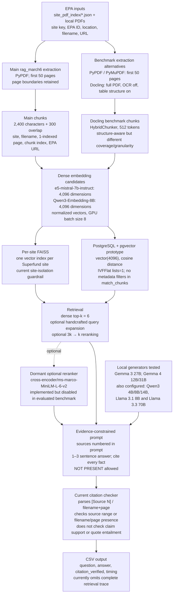
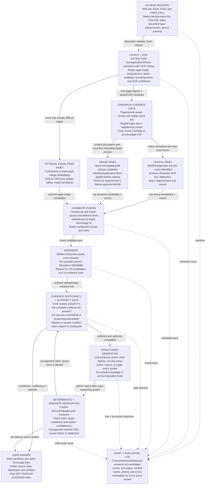

# Superfund RAG architecture review

**Date:** 22 October 2026
**Scope:** Read-only review of the Unity repository at `/work/pi_larsonj_wit_edu/superfund/project/superfund`, concentrating on `benchmark_rag.py`, `rag_march6`, and `docling-rag-agent`.
**Status:** Architecture assessment; no remote files changed.

## Verdict

The architecture is appropriately simple for a research prototype. The project already has the right broad pieces:

### Version 1 — compact conceptual architecture

```text
EPA/site data
    ↓
PDF extraction and page-aware chunking
    ↓
embeddings + site-scoped FAISS / PostgreSQL-pgvector
    ↓
retrieval
    ↓
evidence-constrained generation
    ↓
citation checking
```

The highest-value next step is **not** a more complicated agent architecture. It is to make the evidence chain real, fail closed when it breaks, and turn the benchmark into a controlled scientific evaluation.

At present, the normal `rag_march6` ingestion path is better than the benchmark path: it preserves 1-indexed pages, site, filename, and EPA URL (`rag_march6/extract.py:47-111`; `rag_march6/index.py:35-49`). `benchmark_rag.py` bypasses that work and loses much of the provenance. The core design should therefore be retained and tightened rather than replaced.

### Version 2 — current implementation, with actual components



This diagram contains two partially overlapping implementations rather than one coherent production path. The immediate refactor should make the benchmark call the same page-aware ingestion and retrieval interfaces as the application.

### Version 3 — proposed evidence-aware architecture, with labeled transitions



The target design is still a conventional RAG pipeline. The additions are evidence contracts, metadata enforcement, an explicit sufficiency gate, and complete observability—not an autonomous multi-agent system.

## Embedding and retrieval model decision

### Recommendation

Keep `Qwen3-Embedding-8B` as the primary dense candidate for now. It is already a modern instruction-aware model with a 32K sequence length, 4,096-dimensional output, and Matryoshka Representation Learning support. The model family also provides 0.6B and 4B efficiency variants and matching rerankers. Its own model card reports that correct task instructions typically improve downstream performance, yet the current `HuggingFaceEmbeddings` setup does not explicitly supply distinct query and document instructions. Fix and measure that before replacing the model. See the [official Qwen3 model card](https://huggingface.co/Qwen/Qwen3-Embedding-8B).

The bigger likely improvement is **hybrid retrieval plus a stronger reranker**:

1. Add a transparent BM25 lexical lane and fuse it with Qwen3 dense retrieval using reciprocal-rank fusion.
2. Benchmark no reranker against `Qwen3-Reranker-0.6B` and `Qwen3-Reranker-4B`; optionally include the dormant `ms-marco-MiniLM-L-6-v2` helper as a legacy comparator. Test Qwen3 8B only if the incremental gain justifies latency and GPU memory.
3. Save original dense/lexical scores, fused ranks, and reranker scores rather than discarding them.
4. Evaluate on gold retrieval labels before choosing any model.

### Candidate matrix

| Candidate | Role | Why consider it | Recommendation |
|---|---|---|---|
| `e5-mistral-7b-instruct` | Current dense baseline | Strong historical baseline already deployed; 4,096 dimensions and long context | Keep as a comparison, but supply its required query instruction correctly |
| `Qwen3-Embedding-8B` | Primary dense candidate | Already in the repo; 32K context, instruction-aware, 4,096 dimensions, MRL | **Keep and configure correctly before changing models** |
| `Qwen3-Embedding-4B` | Efficiency candidate | Same family, 2,560 dimensions and lower inference/index cost | Benchmark if 8B throughput or storage is a concern |
| `Qwen3-Embedding-8B` at 1,024/2,048 dimensions | Storage/latency ablation | MRL may reduce index size while retaining useful recall | Benchmark alongside full 4,096 dimensions |
| `BAAI/bge-m3` | Hybrid/multilingual alternative | Produces dense, learned sparse, and multi-vector representations; 1,024 dimensions; supports inputs up to 8,192 tokens | Useful experimental arm, but compare it to simpler BM25 + Qwen3 rather than assuming a unified model is better; see the [official model card](https://huggingface.co/BAAI/bge-m3) |
| ColPali or Jina Embeddings v4 | Visual page-retrieval lane | Retrieves document-page images directly, retaining visual layout, tables and figures that OCR/text retrieval can miss | Add only for a labeled OCR/table/map cohort; do not replace the text index. See [ColPali](https://arxiv.org/abs/2407.01449) and the [Jina v4 model card](https://huggingface.co/jinaai/jina-embeddings-v4) |

### Embedding experiments that are worth running

- Use the same canonical chunks and gold queries for every model.
- Follow each model's official query/document formatting and instructions.
- Compare Recall@5/10/50, nDCG@10, MRR, complete-evidence-set recall, index size, embedding throughput and query latency.
- Stratify results by exact-identifier, ordinary semantic, temporal, multi-document, OCR-degraded and unanswerable questions.
- Evaluate both full-corpus and site-filtered retrieval.
- Tune only on a development split; select once on a held-out test set.
- Report confidence intervals and paired query-level differences, not just global means.

Do not select an embedding model using generated answer quality alone. A generator can conceal retrieval failures, and a judge model can reward fluent answers from the wrong evidence.

## What is already good

- **Separation of concerns:** scraping, extraction/chunking, indexing, retrieval, generation, and verification are separate enough to test independently.
- **Site-scoped FAISS indexes:** this is a useful guardrail against cross-site contamination for site-specific questions.
- **Page-aware main ingestion path:** normal `rag_march6` extraction keeps page metadata and EPA URLs.
- **Deterministic benchmark generation:** decoding parameters are fixed in `benchmark_rag.py:218-221`.
- **Grounding-oriented prompt:** `rag_march6/generate.py:49-60` instructs the model to use the supplied context, cite sources, and return `NOT PRESENT` when appropriate.
- **A no-RAG comparator and staged experiments:** these are useful building blocks, even though the present scoring cannot yet support accuracy claims.
- **Authoritative site metadata exists:** for example, the Love Canal JSON contains the EPA site ID, Niagara Falls location, state, and EPA document URLs. This can become a strong structured-evidence layer.

## Critical findings

### 1. `citation_verified` does not mean a citation was verified

This is the most important correctness problem.

- `rag_march6/verify.py:79-88` treats an answer with no parsed citations as valid.
- `verify.py:97-105` only checks that `[Source N]` refers to an in-range retrieved chunk.
- A cited page number is parsed but not validated.
- `find_quote_in_chunks` at `verify.py:26-39` exists but is never called by `verify_answer`.
- The optional verification threshold is unused.
- Grouped forms such as `[Source 1, Source 3]` do not match the regex at `verify.py:53-58`; they are consequently treated as having no citations and still pass.

The saved results illustrate the effect:

- All extractor rows pass: 72/72.
- All embedding rows pass: 48/48.
- All LLM rows pass: 24/24 per model.
- All retrieval-tuning rows pass: 864/864.
- Only 639 of the 864 retrieval-tuning answers contain even one citation that the current regex can parse.

A concrete false answer passes: `output/benchmark/llms/benchmark_gemma4-12b.csv` says Love Canal is in Lewiston, New York and marks the answer `citation_verified=True`; the site metadata identifies Niagara Falls.

**Consequence:** no result using the current boolean should be described as citation-correct, supported, faithful, verified, or hallucination-free.

**Fix:** make verification claim based. The answer format should contain atomic records such as:

```json
{
  "claim": "The site is located in Niagara Falls, New York.",
  "source_id": "...",
  "page": 12,
  "exact_quote": "..."
}
```

Then require all of the following:

1. the source and page exist;
2. the exact quote occurs on that page after documented normalization;
3. the quote entails the claim;
4. every material claim has evidence;
5. failure produces abstention or an explicitly unverified response.

### 2. The benchmark discards page provenance

- `benchmark_rag.py:119-130` concatenates pages and slices the result at arbitrary character offsets.
- `benchmark_rag.py:157-162` records filename and chunk index, but not page or EPA URL.
- `rag_march6/retrieve.py:94-100` defaults missing pages to `0`.
- `benchmark_rag.py:226-236` can therefore report `p0` as evidence.
- Result rows at `benchmark_rag.py:312-322` omit retrieved text, filename/page, rank, score, raw output, verification details, and constructed evidence.

This is a benchmark regression, not a limitation of the main pipeline. Reuse the page-aware extraction and indexing path in the benchmark.

### 3. The extraction comparison is not controlled

- PyPDF and PyMuPDF read only the first 50 pages (`benchmark_rag.py:53-85`).
- Docling ignores the supplied `max_pages` argument and processes the full PDF (`benchmark_rag.py:88-105`).
- PyPDF/PyMuPDF results are split into 2,400-character windows (`benchmark_rag.py:119-130`).
- Docling uses its own 512-token hybrid chunker (`benchmark_rag.py:88-105`, `151-157`).
- OCR is disabled, so scanned documents vanish from the comparison rather than becoming an explicit failure cohort.

The resulting chunk counts show the confound:

| Site | PyPDF | PyMuPDF | Docling |
|---|---:|---:|---:|
| Love Canal | 345 | 348 | 2,057 |
| U.S. Smelter | 228 | 285 | 1,350 |

These runs compare extractor, page coverage, and chunking simultaneously. They cannot isolate an extractor effect.

**Fix:** use the same pages, normalized page objects, and same downstream chunker for all extractors. Run a separate chunking experiment. Put scanned/OCR pages in their own stratum.

### 4. There is no reliable abstention boundary

- FAISS returns the nearest `k` chunks even when all are irrelevant (`rag_march6/retrieve.py:75-105`).
- The PostgreSQL path also treats every nonempty top-k result as relevant (`docling-rag-agent/rag_agent.py:72-101`; `docling-rag-agent/schema.sql:55-67`).
- There are no intentionally unanswerable or adversarial benchmark questions.

The prompt's `NOT PRESENT` instruction is useful, but prompt compliance is not a calibrated evidence-sufficiency mechanism.

**Fix:** create answerable and unanswerable validation sets, save raw retrieval scores, and calibrate a support/sufficiency gate. Report abstention precision, recall, answer coverage, and risk-coverage curves.

### 5. The current question set is exploratory, not a publishable benchmark

`questions_ella.txt:4-11` contains eight generic templates. There are no gold answers, gold passages, complete evidence sets, unanswerable labels, or annotation/adjudication records. The same questions are used to tune and report configurations. Query expansion rules in `rag_march6/retrieve.py:11-39` also target these kinds of questions, increasing overfitting risk.

There is currently no measurement of:

- Recall@k, MRR, or nDCG;
- complete-evidence-set recall;
- answer correctness;
- citation entailment or completeness;
- wrong-site leakage;
- temporal/version errors;
- abstention performance.

**Fix:** freeze a development set and a held-out expert-reviewed test set. Keep test labels hidden during system selection.

### 6. The saved “evidence” is not linked to claims

`rag_march6/generate.py:93-105`, `retrieve.py:117-135`, and `benchmark_rag.py:226-236` treat the top/first retrieved chunks as evidence. This does not establish that the generator used those passages or that they support each statement.

Use the term **retrieved context** for these chunks. Reserve **evidence** for claim-linked passages that pass validation.

## Important secondary findings

### Retrieval and metadata

- The evaluated path is dense-only; optional expansion and reranking are disabled in `benchmark_rag.py:308`.
- Add BM25 and hybrid rank-fusion baselines. Exact chemical names, EPA/CERCLIS IDs, dates, addresses, and legal phrases are favorable cases for lexical retrieval.
- PostgreSQL search has no site, date, document-type, or authority/status constraint (`docling-rag-agent/schema.sql:38-67`). `SearchRequest.filters` exists in `models.py:25-31` but is unused.
- Per-site FAISS is a good present guardrail, but thousands of separate indexes will complicate cache management and cross-site questions. A partitioned/global index with enforced metadata filters is a reasonable later option.
- Hard-coded query expansion can drift (`rag_march6/retrieve.py:11-39`). The optional reranker also discards its scores when enabled (`retrieve.py:61-72`), although the evaluated benchmark currently leaves both expansion and reranking off. Log original/expanded queries and all component scores in any arm that enables them.

### Question type

Fixed `top_k=6` and a one-to-three-sentence answer prompt cannot support exhaustive requests such as “list every contaminant” or “list all responsible entities.” Those are aggregation tasks. Either exclude them from ordinary QA or implement iterative/corpus-wide retrieval and score set precision and recall.

### Generation

- `strip_cot` in `rag_march6/generate.py:10-31` uses broad textual markers and can truncate valid content; saved results still leak literal `thought` text.
- The older agent permits outside “general guidance” (`docling-rag-agent/rag_agent.py:112-121`), weakening an archive-bounded guarantee.
- The older agent streams output before any validation (`rag_agent.py:159-173`). For high-confidence mode, validate before release.
- Retrieved text is inserted into the model context without a strong data/instruction boundary. Treat documents as untrusted data and test prompt injection embedded in records.

### Security and implementation consistency

- `rag_march6/index.py:90-95` loads FAISS with `allow_dangerous_deserialization=True`. On a shared HPC filesystem, a modified pickle-backed index could execute code. Use a safe format or protect and checksum trusted index artifacts.
- The database schema expects `vector(4096)` (`docling-rag-agent/schema.sql:23-39`), while `models.py:120-126` enforces 1,536 dimensions.
- The pgvector IVFFlat index uses `lists=1` (`schema.sql:34`), which is not a meaningful million-scale configuration. Benchmark HNSW or tune IVFFlat after measuring corpus size and recall/latency.
- Raw database exception strings can be returned to the model/user (`docling-rag-agent/rag_agent.py:103-105`). Log internal details and return a generic external error.
- Conversation history is unbounded in the older agent.

### Benchmark statistics and reporting

- Extractors are run once, in a fixed order, with no warmup, randomization, repeated trials, or uncertainty intervals.
- Docling constructs a new `DocumentConverter` per PDF, inflating batch cost.
- A fixed random seed is undermined when sampling from an unsorted `os.listdir` result.
- SLURM jobs may run on different GPU classes; hardware is not controlled in reported comparisons.
- Some prose result counts use physical CSV lines even though answers contain newlines. For example, a reported 1,496 retrieval rows parses as 864 CSV records.
- The checked-in/current extraction CSV does not reproduce the prose timing summary. Proper parsing gives approximate means of 0.390 s for PyPDF, 0.037 s for PyMuPDF, and 15.63 s for Docling, with large outliers and errors that should be disclosed.
- The scalability experiment uses only three sites. It therefore does not test 4,592-site scalability.
- Global metadata filtering is applied after fetching candidates and returns fewer results than the per-site path, making latency and answer comparisons unequal.

Generate paper tables directly from machine-readable run manifests rather than copying figures into prose.

### Reproducibility

- The remote Git repository has no commits yet, so no result can be tied to an immutable revision.
- Dependencies are unpinned and benchmark-specific packages are missing from the basic requirements file.
- Model snapshot selection uses `os.listdir()[0]`, which is nondeterministic (`benchmark_rag.py:179-184`).
- The label `gemma4-27b` points to a 31B model path (`benchmark_rag.py:40-43`).
- Extraction errors are caught and skipped without a complete failure manifest.
- Fixed output filenames can be overwritten by later runs.

Before reporting results, save for every run:

- Git commit/tag and dirty-state check;
- environment lock/container digest;
- model repository and immutable revision;
- corpus manifest and hashes;
- parser/OCR/chunker configuration;
- index type, parameters, and checksum;
- prompts and random seeds;
- hardware/node/GPU information;
- every retrieved chunk ID, rank, score, source, page, and text;
- raw model output and structured verification result;
- error/failure manifest;
- unique run ID and timestamp.

## Recommended decision

**Keep the simple architecture. Replace the current “verifier” and benchmark before adding agentic complexity.**

### Options considered

| Option | Complexity | Scientific value | Recommendation |
|---|---:|---:|---|
| Add agents, query planning, or graph workflows now | High | Low until evaluation is trustworthy | Defer |
| Replace FAISS/pgvector or change the LLM first | Medium | Limited; present failures are mostly evaluation/provenance failures | Defer |
| Keep baseline and build provenance, verification, abstention, and a gold benchmark | Medium | Very high | **Do now** |

## Implementation plan: what needs fixing first

The phases below are ordered by dependency. Do not begin model selection before Phases 0–3 are usable: without reproducibility, provenance, real verification and gold retrieval labels, better models cannot be identified scientifically.

### Phase 0 — freeze a reproducible baseline

**Purpose:** make every later result attributable to immutable code, data and model versions.

**Work:**

1. Create the first Git commit after excluding PDFs, model weights, database storage, indexes and generated outputs appropriately.
2. Create an environment lock or container definition that includes benchmark dependencies such as PyMuPDF and Docling.
3. Replace `os.listdir()[0]` model resolution with explicit immutable snapshot paths.
4. Correct the `gemma4-27b`/31B naming mismatch.
5. Introduce a unique `run_id` directory; never overwrite an earlier run.
6. Write `run_manifest.json` containing Git commit/dirty state, model and embedding revisions, corpus/index hashes, prompts, configuration, seed, node/GPU and timestamps.
7. Generate summaries from parsed CSV/JSONL rather than hand-copying values into prose.

**Exit criteria:**

- A second execution using the same manifest selects the same inputs, model revisions and indexes.
- Every reported table links to a run ID and Git commit.
- Failures and skipped PDFs appear in a machine-readable manifest.

**Likely effort:** small to medium. This should be the first checkpoint before changing behavior.

### Phase 1 — define one canonical provenance contract

**Purpose:** make the application and benchmark use the same evidence-preserving data model.

**Proposed records:**

```text
SourceDocument
  document_id, document_sha256, site_key, EPA site ID, filename, EPA URL,
  title, document_date, document_type, status/version, extractor revision

EvidenceChunk
  chunk_id, document_id, page_start, page_end, text, exact offsets,
  heading path, table/figure flags, OCR confidence, chunker revision
```

**Work:**

1. Extend the existing `PageChunk` rather than inventing a parallel benchmark object.
2. Generate deterministic document and chunk IDs from the document hash and page/span coordinates.
3. Make full-document coverage the default. If a page cap is required for an experiment, record it explicitly in the manifest and label the run partial-corpus.
4. Make `benchmark_rag.py` call the shared extraction/chunking functions used by `rag_march6`.
5. Preserve page boundaries through every extractor. Normalize extractor output to page objects before applying a shared chunker.
6. Carry EPA URL, site ID, location, document date/type/status, page, offsets and extraction/OCR quality into FAISS/PostgreSQL metadata.
7. Store source metadata and text separately from embedding vectors so indexes can be rebuilt without losing provenance.

**Tests:**

- Round-trip a known PDF page and assert that retrieved text maps back to the original file, page and exact span.
- Assert that no indexed chunk has page `0`, missing document ID or missing site key.
- Assert that the benchmark and application produce identical chunk IDs for the same configuration.
- Assert that two sites containing similar language cannot exchange chunks under a site-scoped query.

**Exit criteria:** every retrieved item can be opened at the correct original page, and benchmark/application provenance is identical.

**Likely effort:** medium; highest-leverage refactor.

### Phase 2 — replace free-form citations with a fail-closed evidence contract

**Purpose:** make “verified” mean supported, not merely syntactically cited.

**Proposed response schema:**

```json
{
  "status": "answered | insufficient_evidence | conflicting_evidence",
  "claims": [
    {
      "claim": "...",
      "source_id": "...",
      "page": 12,
      "exact_quote": "..."
    }
  ],
  "answer": "..."
}
```

**Work:**

1. Add Pydantic/dataclass models such as `EvidenceClaim`, `AnswerEnvelope` and `ClaimVerification`.
2. Make the generator return structured data. Build displayed prose only from the accepted claim objects.
3. Rewrite `verify_answer` so no substantive uncited claim can pass.
4. Verify document ID, page and exact quotation deterministically.
5. Add a separate entailment check between each claim and quote. Treat an LLM/NLI judge as a fallible measurement component and calibrate it against humans.
6. Measure citation completeness: all material claims require support, not only claims that happen to contain citation syntax.
7. Allow at most one constrained repair attempt. If verification still fails, return `insufficient_evidence` rather than streaming the answer.
8. Rename existing top chunks from “evidence” to “retrieved context.”

**Required regression tests:**

- no citation;
- out-of-range source;
- correct source but wrong page;
- quote absent from page;
- quote present but does not entail the claim;
- one supported and one unsupported claim;
- grouped citations;
- `NOT PRESENT` combined with claims;
- wrong-site citation;
- proposed/superseded document represented as current/final;
- the saved false “Love Canal is in Lewiston” example.

**Exit criteria:** all of the adversarial cases above fail closed, and every accepted answer can be reconstructed exclusively from verified claim objects.

**Likely effort:** medium.

### Phase 3 — build a gold development and held-out test collection

**Purpose:** create the ground truth needed to choose retrieval, embedding, reranking and abstention settings.

**Initial pilot:** approximately 80–120 questions across at least five sites, followed by expansion after the annotation workflow is stable. Include approximately 15–25% genuinely unanswerable questions. Exact sample size should follow annotation capacity and the desired confidence interval rather than an arbitrary leaderboard target.

**Question strata:**

- single-page facts and exact identifiers;
- contaminant/entity lists scored as sets;
- document dates, site chronology and “what changed?” questions;
- multi-document synthesis;
- conflicting, proposed, final, amended and superseded records;
- cross-site distractors;
- OCR-degraded scans, tables, figures, maps and appendices;
- ambiguous public-language questions;
- unanswerable and out-of-scope questions;
- multi-turn topic drift.

**Gold fields:** question, site scope, answerability, canonical answer/claims, complete minimal evidence set, acceptable alternate evidence, source authority/status, question type, difficulty, annotators and adjudication.

**Work:**

1. Write annotation guidance before labeling.
2. Double-annotate a meaningful subset and report agreement.
3. Adjudicate disagreements with a domain expert/archivist.
4. Freeze development and held-out test splits before tuning retrieval.
5. Version the dataset independently from the corpus.

**Exit criteria:** the system can be evaluated for retrieval independently of generation, and the held-out test labels have not informed model/configuration choices.

**Likely effort:** large and scientifically essential.

### Phase 4 — implement and evaluate retrieval plus abstention

**Purpose:** choose the simplest retrieval stack that achieves adequate evidence recall.

**Retrieval arms:**

1. BM25/fielded lexical retrieval.
2. `e5-mistral-7b-instruct`, with correct query instructions.
3. `Qwen3-Embedding-8B`, with correct task instructions.
4. Qwen3 MRL dimension ablations and optionally the 4B model.
5. BM25 + Qwen3 reciprocal-rank fusion.
6. Hybrid candidates with no reranker versus the dormant MiniLM helper and Qwen3 rerankers.
7. Optional BGE-M3 hybrid arm.

**Work:**

1. Retrieve a larger candidate pool—such as 50–100—then rerank to the generation context size.
2. Apply site/date/type/status filters before vector ranking, not after top-k retrieval.
3. Preserve all component scores and ranks.
4. Calibrate a context-sufficiency/support gate on development data.
5. Add explicit conflict detection for evidence with incompatible dates/statuses.
6. Evaluate context sizes rather than assuming `top_k=6`.

**Metrics:** Recall@k, MRR, nDCG, complete-evidence-set recall, wrong-site leakage, latency, index size, abstention precision/recall, answer coverage and risk-coverage curves.

**Exit criteria:** a preregistered configuration is selected on development data and evaluated exactly once on the held-out test set.

**Likely effort:** medium after Phase 3 exists.

### Phase 5 — rerun extraction, OCR and chunking as controlled experiments

**Purpose:** determine which document-processing choices improve evidence retrieval without confounding coverage and chunking.

**Work:**

1. Feed each extractor the identical documents and page ranges.
2. Normalize output into common page objects.
3. Apply an identical downstream chunker for the extractor-only comparison.
4. Run a separate chunker comparison: character/page-aware baseline versus Docling structural chunks and, if useful, parent-child retrieval.
5. Route image-only/low-text pages through OCR and record OCR engine, confidence and errors.
6. Evaluate tables, maps and figures as a distinct cohort; only then test a visual retriever.
7. Randomize method order, warm up models, repeat timing runs on fixed hardware, and report medians, percentiles, confidence intervals and errors.

**Exit criteria:** extraction, OCR and chunking effects can each be interpreted independently.

**Likely effort:** medium to large depending on OCR and visual retrieval scope.

### Phase 6 — harden storage and scale only after correctness

**Purpose:** make the validated workflow safe and scalable without altering its scientific behavior.

**Work:**

1. Remove unsafe pickle deserialization or protect FAISS artifacts with ownership controls and verified checksums.
2. Resolve the 1,536-versus-4,096 embedding-dimension conflict and derive dimensions from the index manifest rather than a hard-coded validator.
3. Implement pre-filtered PostgreSQL retrieval by site, date, type and status.
4. Replace `IVFFlat lists=1` with a measured HNSW or properly tuned IVFFlat configuration.
5. Compare per-site indexes with a partitioned/global filtered index using many more than three sites.
6. Return generic external errors and keep internal database details in logs.
7. Bound conversation history and test prompt injection in retrieved documents.

**Exit criteria:** the scaled path reproduces the selected baseline's retrieval results within stated tolerances and passes the same evidence-verification tests.

### Suggested first implementation slice

The first coding session should remain deliberately narrow:

1. Commit/tag the current prototype and create a run-manifest schema.
2. Refactor `benchmark_rag.py` to reuse `rag_march6.extract.PageChunk` and page-aware indexing.
3. Save a JSONL retrieval trace for every query: chunk ID, document ID, site, page, rank, dense score, text and EPA URL.
4. Introduce `EvidenceClaim`/`AnswerEnvelope` models.
5. Rewrite `verify_answer` to reject uncited answers and wrong source/page/quote combinations.
6. Add regression tests for the known Love Canal false answer and the citation-parser edge cases.

Completing this slice would not make the system paper-ready, but it would turn the current prototype into a trustworthy foundation for the gold benchmark and model comparisons.

## Low-complexity first pass

The first round should favor changes that are easy to reverse and easy to measure. “Modern” should not mean replacing every component at once.

| Change | Complexity | Recommendation | Acceptance check |
|---|---:|---|---|
| Remove the 50-page extraction cap | Low | **Done in the active cluster extraction and benchmark paths.** Normal runs now cover all pages; an explicit cap remains available only for smoke tests. | A 185-page EPA PDF produced text through page 185. |
| Define one five-site pilot manifest and one question file | Low | **Done for the pilot launcher.** Use Anaconda, Silver Bow/Butte, Milltown, California Gulch and Summitville with the five reviewed mining questions. | Exactly five site rows and five non-comment questions; output rows identify both site and question. |
| Save run configuration and retrieval traces | Low | Do next. Record corpus version, extractor, page policy, chunking, embedding, query instruction, index ID, top-k, reranker, prompt, model and seed. | Every answer can be reproduced and every retrieved chunk maps to a file and page. |
| Configure Qwen3 correctly | Low | Keep `Qwen3-Embedding-8B` as the modern dense candidate. Add its retrieval task instruction to queries and leave documents unprefixed, following the model card; do not call an un-instructed run “Qwen3 configured.” | Compare instructed versus un-instructed retrieval on the frozen pilot without changing any other setting. |
| Make the present citation check fail closed | Low–medium | Reject answers with no valid citation, an out-of-range citation, a quote absent from the cited page, or a citation from another site. This is a minimum safety gate, not full factuality verification. | All adversarial citation tests reject; correct cited answers still pass. |
| Add BM25 and reciprocal-rank fusion | Low–medium | Add this before changing databases or adopting a learned sparse retriever. It is cheap, transparent and especially appropriate for chemical names, EPA IDs, dates and legal phrases. | Measure BM25, dense and fused Recall@k separately; keep fusion only if it improves evidence recall or robustness. |
| Add and compare a learned reranker | Medium | The benchmark currently has no active reranker. Test after candidate retrieval is instrumented, starting with Qwen3 0.6B or 4B; include dormant MiniLM only as a legacy comparator. | Better nDCG/complete-evidence recall than no reranker at an acceptable latency and memory cost. |
| OCR/visual retrieval, knowledge graphs, agents or a storage rewrite | High | Defer. These are useful only after the simple textual baseline and evaluation set are trustworthy. | Each addition must improve a predefined difficult cohort rather than only overall anecdotes. |

### What BM25 is

BM25 is a lexical, or word-matching, retrieval algorithm. It does not use a neural model and it does not “understand” text in the embedding sense. For every query term, it gives a document a larger score when:

1. the term occurs in the document;
2. the term is rare across the collection, and is therefore informative; and
3. the document contains the term enough times to be meaningful, with diminishing returns rather than an unlimited reward for repetition.

It also normalizes for document length so a long report does not win merely because it contains more words. The usual score is a sum over query terms using term frequency, inverse document frequency and two tunable constants (`k1` for term-frequency saturation and `b` for length normalization).

For this project, BM25 is likely to retrieve exact strings such as `MTD093291656`, `08100007971`, `PFOA`, `250 mg/kg`, an operable-unit name, a company name or a quoted remedy phrase. Dense embeddings are more likely to retrieve paraphrases, such as matching “soil replacement threshold” to “residential action level.” The two methods therefore fail differently.

The recommended design is not “BM25 instead of embeddings.” It is:

```text
question
  ├─ BM25 over the same page-aware chunks ───────┐
  └─ Qwen3 dense retrieval over those chunks ────┤
                                                  ↓ reciprocal-rank fusion
                                        combined candidate list
                                                  ↓ reranking
                                         evidence sent to the LLM
```

Reciprocal-rank fusion (RRF) combines ranks rather than incomparable BM25 and cosine scores. A common form adds `1 / (k + rank)` for each list in which a chunk appears. This makes the first implementation small: keep the same chunks, retrieve perhaps 50 from each lane, fuse them, and then rerank to the 6–10 evidence units passed to generation. BM25 itself needs no GPU. With the existing FAISS design, this is a modest code addition rather than a database migration.

### Five-site benchmark starting point

The cluster presently supports a practical five-site pilot:

- Anaconda Co. Smelter (`MTD093291656`)
- Silver Bow Creek/Butte Area (`MTD980502777`)
- Milltown Reservoir Sediments (`MTD980717565`)
- California Gulch (`COD980717938`)
- Summitville Mine (`COD983778432`)

The shared question file contains five reviewed mining questions concerning mining history, responsible companies, health harms, public concerns and remedy changes. The existing `rag_aj_extra_questions_10-22-26.csv` is stronger gold data but currently covers only the first three sites, with five additional site-specific questions per site and expected answers/source pages. Those two assets should not be conflated: the five-by-five pilot supplies breadth, while the 15-row site-specific CSV supplies better evidence-level scoring for three sites.

Run the following four retrieval arms on identical all-page chunks:

1. current E5 dense baseline;
2. correctly instructed Qwen3 dense retrieval;
3. BM25 only; and
4. Qwen3 + BM25 with RRF.

For the three sites with source-page labels, report Recall@5/10/20, MRR and complete-evidence-set recall before generating answers. For all five sites, report answer grade, valid-citation rate, wrong-site leakage, abstention behavior, indexing time, query latency and index size. Do not select a method from answer prose alone: if the gold page never entered the context, generation cannot repair the retrieval failure reliably.

### Revised “what needs fixing first” plan

1. **Freeze the benchmark inputs.** **Staged for the five-site runner:** the five-site manifest and five reviewed questions are versioned, and the new TSV uses stable semantic question IDs rather than row position. The 15-row evidence-label set still needs the same versioned release treatment.
2. **Finish provenance logging.** Make the benchmark retain file, page, chunk ID, site, URL, component ranks and scores. This is required before evaluating Qwen3 or BM25.
3. **Run the Qwen3 instruction ablation.** Compare the current E5 run, un-instructed Qwen3 and correctly instructed Qwen3 on the same all-page corpus. This is the easiest modern-embedding improvement to test.
4. **Add BM25 + RRF.** Treat it as a required baseline, not an optional embellishment. Exact terminology is too important in this corpus to rely on dense retrieval alone.
5. **Tighten the verifier enough to fail closed.** Do the deterministic citation/file/page/quote checks before a larger claim-level verifier. An answer that fails should become `insufficient_evidence`, not a warning attached to fluent prose.
6. **Only then test a reranker.** The benchmark path currently calls `retrieve(..., rerank=False)`, so the existing MiniLM helper is dormant. Compare no reranker with Qwen3-Reranker-0.6B or 4B using the saved candidate sets.
7. **Expand gold labels.** Add exact expected claims and evidence pages for California Gulch and Summitville, then create a held-out split before tuning further.

### Git workflow

The cluster checkout is not a safe source for a wholesale push: it currently has no local commits and contains a large mixture of code, PDFs, indexes and generated outputs. The GitHub repository `wit-superfund/superfund-site-rag` should be updated from a clean clone by selectively importing code, benchmark manifests, tests and documentation. Data, model snapshots, virtual environments, FAISS indexes, logs and generated answer files should remain ignored. This keeps the paper's implementation reviewable without publishing bulky or sensitive artifacts accidentally.

### Ablation and timing protocol

Maintain two linked experiment series rather than only comparing an old and a final system:

1. **Individual ablations:** start from a frozen baseline and change exactly one factor. These establish whether all-page coverage, instructed Qwen3, BM25/RRF, strict verification or a new reranker contributes on its own.
2. **Incremental ladder:** add retained changes one at a time in the intended deployment order. This measures interactions and the cost/quality trajectory of the combined system.

The initial matrix is:

| ID | Series | Configuration/change |
|---|---|---|
| `B0` | Baseline | E5 dense retrieval, 50-page historical cap, no reranker, current verifier |
| `I_pages` | Individual | `B0`, but all pages |
| `I_qwen_raw` | Calibration | `B0`, but Qwen3 without a task instruction; diagnostic only |
| `I_qwen` | Individual | `B0`, but correctly instructed Qwen3 |
| `I_bm25` | Component | BM25-only lexical baseline |
| `I_hybrid` | Individual | `B0`, but E5 + BM25 with RRF |
| `I_verify` | Individual | `B0`, but fail-closed verification |
| `I_rerank` | Individual | `B0`, but Qwen3-Reranker-0.6B |
| `L1` | Incremental | Baseline + all pages; identical to `I_pages`, so reuse that result |
| `L2` | Incremental | `L1` + instructed Qwen3 |
| `L3` | Incremental | `L2` + BM25/RRF |
| `L4` | Incremental | `L3` + fail-closed verification |
| `L5` | Incremental | `L4` + Qwen3 reranker |

Freeze site/question/corpus manifests, chunking, generator, prompt, decoding and top-k unless the matrix says otherwise. Each run ID gets an immutable directory containing:

- a run manifest with code hash/commit, corpus and input hashes, exact model snapshots and every parameter;
- answer rows and abstention/verification results;
- complete retrieval traces with document, page, chunk, component scores/ranks, fused rank and selected-context status;
- extraction, embedding, indexing, retrieval, reranking, verification, generation and total wall-clock timings;
- chunk/vector counts, index bytes, maximum CPU memory and peak GPU memory where available; and
- extraction/model errors and retry counts.

The current benchmark already saves extraction, embedding, model-load, retrieval and generation timings. The new five-site launcher also writes a per-site configuration manifest and GNU `time -v` resource report. Candidate-level retrieval traces, index byte counts, verification timing and peak GPU memory should be added before the full matrix is executed.

Evaluate paired differences for the same site/question. With only 25 shared site-question cases—and evidence-page labels presently strongest for 15 additional questions over three sites—report per-question deltas and uncertainty rather than relying on a single average. Predeclare a primary quality measure and compute limits before choosing the winner. A change may also be retained for eliminating a serious safety failure even if average answer quality is flat. Negative/null results stay in the paper and repository; “revert” means excluding the change from the selected configuration, not deleting its experimental record.

### Architectural additions to defer

Iterative retrieval for multi-hop questions, knowledge/authority graphs, hierarchical navigation, cross-site agents and autonomous query planning may eventually help. Each should be an ablation introduced only after the evidence pipeline and held-out benchmark exist, and each should earn its complexity through a measured improvement.

## Proposed paper claim

Do not claim that the current system prevents hallucinations. A defensible target after the changes above is:

> We evaluate a provenance-preserving, site-aware RAG workflow for longitudinal Superfund records. The system links atomic claims to exact document pages and quotations, detects insufficient or conflicting evidence, and abstains when support is inadequate. We separately report retrieval, citation, answer, temporal, OCR, cross-site, and selective-answering failures.

The publishable novelty is likely to be this evidence and evaluation layer, not architectural complexity.
